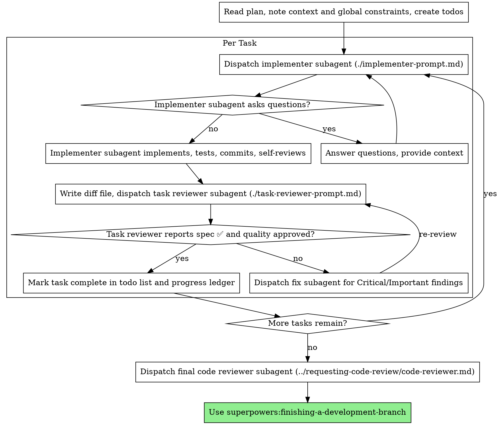

# Subagent-Driven Development

Execute plan by dispatching a fresh implementer subagent per task, a task review (spec compliance + code quality) after each, and a broad whole-branch review at the end.

**Why subagents:** You delegate tasks to specialized agents with isolated context. They never inherit your session's history — you construct exactly what they need, which keeps them focused and preserves your own context for coordination.

**Core principle:** Fresh subagent per task + task review (spec + quality) + broad final review = high quality, fast iteration

**Narration:** between tool calls, narrate at most one short line — the ledger and the tool results carry the record.

**Continuous execution:** Do not pause to check in with your human partner between tasks. The only reasons to stop: BLOCKED status you cannot resolve, ambiguity that genuinely prevents progress, or all tasks complete. "Should I continue?" prompts and progress summaries waste their time.

## When to Use

Use this skill when you have an implementation plan, the tasks are mostly independent, and you're staying in this session. Tightly coupled tasks or no plan → manual execution or brainstorm first. Want a separate parallel session with human checkpoints → **superpowers:executing-plans**. Compared to that skill, this one gives same-session execution, a fresh subagent per task (no context pollution), automatic review after each task, and faster iteration (no human-in-loop between tasks).

## The Process



## Pre-Flight Plan Review

Before dispatching Task 1, scan the plan once for: tasks that contradict each other or the plan's Global Constraints, and anything the plan explicitly mandates that the review rubric treats as a defect (a test that asserts nothing, verbatim duplication of a logic block). Present everything found to your human partner as one batched question — each finding beside the plan text that mandates it, asking which governs — not one interrupt per discovery mid-plan. If the scan is clean, proceed without comment. The review loop remains the net for conflicts that only emerge from implementation.

## Model Selection

Use the least powerful model that can handle each role:

| Task | Model |
|------|-------|
| Transcription (plan text contains the complete code) or single-file mechanical fix | Cheapest tier |
| Implementation from prose; 1-2 files with complete spec | Mid-tier |
| Multi-file integration, pattern matching, debugging | Standard |
| Design judgment, broad codebase understanding, architecture | Most capable |
| Task reviews | Mid-tier floor, scaled to the diff's size, complexity, and risk |
| Final whole-branch review | Most capable — never the session default |

**Always specify the model explicitly when dispatching.** An omitted model inherits your session's model — often the most capable and most expensive — which silently defeats this section.

**Turn count beats token price.** Wall-clock and context cost scale with turns, and the cheapest models routinely take 2-3× the turns on multi-step work — costing more overall. Hence the mid-tier floor for reviewers and for implementers working from prose.

## Handling Implementer Status

**DONE:** Generate the review package (`scripts/review-package BASE HEAD`, from this skill's directory — it prints the unique file path it wrote; BASE is the commit you recorded before dispatching the implementer — **never `HEAD~1`, which silently drops all but the last commit of a multi-commit task**), then dispatch the task reviewer with the printed path.

**DONE_WITH_CONCERNS:** Read the concerns before proceeding. Correctness or scope concerns: address before review. Observations (e.g., "this file is getting large"): note them and proceed to review.

**NEEDS_CONTEXT:** Provide the missing context and re-dispatch.

**BLOCKED:** Assess the blocker:
1. Context problem → provide more context, re-dispatch same model
2. Needs more reasoning → re-dispatch with a more capable model
3. Task too large → break it into smaller pieces
4. Plan itself is wrong → escalate to the human

**Never** ignore an escalation or force the same model to retry without changes. If the implementer said it's stuck, something needs to change.

## Handling Reviewer ⚠️ Items

The task reviewer may report "⚠️ Cannot verify from diff" items — requirements that live in unchanged code or span tasks. These don't block the rest of the review, but you must resolve each one yourself before marking the task complete: you hold the plan and cross-task context the reviewer lacks. A confirmed gap is a failed spec review — send it back to the implementer and re-review.

## Constructing Reviewer Prompts

Per-task reviews are task-scoped gates; the broad review happens once, at the final whole-branch review. The reviewer template ([task-reviewer-prompt.md](task-reviewer-prompt.md)) already carries the process rules (YAGNI, test hygiene, review method) — you supply only what's task-specific. When filling it:

- No open-ended directives ("check all uses", "run race tests if useful") without a concrete, task-specific reason.
- Don't ask a reviewer to re-run tests the implementer already ran on the same code — the implementer's report carries the test evidence.
- Never pre-judge findings — don't instruct a reviewer to ignore or not flag an issue. If you believe a finding would be a false positive, let the reviewer raise it and adjudicate in the review loop. If your prompt contains "do not flag," "don't treat X as a defect," "at most Minor," or "the plan chose" — stop: you are pre-judging, usually to spare yourself a review loop. The plan's example code is a starting point, not evidence its weaknesses were chosen.
- The global-constraints block is the reviewer's attention lens: copy the binding requirements verbatim from the plan's Global Constraints section or the spec — exact values, exact formats, stated relationships ("same layout as X", "matches Y").
- Hand the reviewer its diff as a file: `scripts/review-package BASE HEAD` and pass the printed path (or, without bash: `git log --oneline`, `git diff --stat`, and `git diff -U10` for the range, redirected to one uniquely named file). The output never enters your own context; the reviewer sees commits, stat, and full diff in one Read call. Use the recorded BASE — never `HEAD~1`.
- A dispatch prompt describes one task, not the session's history. Don't paste accumulated prior-task summaries — a real session's dispatch hit 42k chars, 99% pasted history. A fresh subagent needs its task, the interfaces it touches, and the global constraints. Nothing else.
- Dispatch fix subagents for Critical and Important findings. Record Minor findings in the progress ledger and point the final whole-branch review at that list to triage what must be fixed before merge. A roll-up nobody reads is a silent discard.
- A finding labeled plan-mandated — or conflicting with the plan's text — is the human's decision: present the finding and the plan text, ask which governs. Don't dismiss it because the plan mandates it, and don't dispatch a fix that contradicts the plan without asking.
- The final whole-branch review gets a package too: `scripts/review-package MERGE_BASE HEAD` (MERGE_BASE = the commit the branch started from, e.g. `git merge-base main HEAD`); include the printed path in the dispatch.
- Every fix dispatch carries the implementer contract: the fix subagent re-runs the tests covering its change and reports results. Name the covering test files in the dispatch — a one-line fix doesn't need the whole suite. Re-dispatch the reviewer only once the fix report contains the covering tests, the command run, and the output.
- If the final whole-branch review returns findings, dispatch ONE fix subagent with the complete findings list — not one fixer per finding. Per-finding fixers each rebuild context and re-run suites; a real session's final-review fix wave cost more than all its tasks combined.

## File Handoffs

Everything you paste into a dispatch prompt — and everything a subagent prints back — stays resident in your context for the rest of the session. Hand artifacts over as files:

- **Task brief:** before dispatching an implementer, run this skill's `scripts/task-brief PLAN_FILE N` — it extracts the task's full text to a uniquely named file and prints the path. The brief stays the single source of requirements. Your dispatch contains: (1) one line on where this task fits in the project; (2) the brief path, introduced as "read this first — it is your requirements, with the exact values to use verbatim"; (3) interfaces and decisions from earlier tasks the brief cannot know; (4) your resolution of any ambiguity you noticed in the brief; (5) the report-file path and report contract. Exact values (numbers, magic strings, signatures, test cases) appear only in the brief.
- **Report file:** name it after the brief (`…/task-N-brief.md` → `…/task-N-report.md`) and put it in the dispatch prompt. The implementer writes the full report there and returns only status, commits, a one-line test summary, and concerns.
- **Reviewer inputs:** the task reviewer gets three paths — the same brief file, the report file, and the review package — plus the global constraints that bind the task.
- Fix dispatches append their fix report (with test results) to the same report file and return a short summary; re-reviews read the updated file.

## Durable Progress

Conversation memory does not survive compaction. Controllers that lost their place have re-dispatched entire completed task sequences — the single most expensive failure observed. Track progress in a ledger file, not only in todos.

- At skill start, check for a ledger: `cat "$(git rev-parse --show-toplevel)/.superpowers/sdd/progress.md"`. Tasks listed there as complete are DONE — do not re-dispatch; resume at the first task not marked complete.
- When a task's review comes back clean, append one line in the same message as your other bookkeeping: `Task N: complete (commits <base7>..<head7>, review clean)`.
- The ledger is your recovery map: the commits it names exist in git even when your context no longer remembers creating them. After compaction, trust the ledger and `git log` over your own recollection.
- `git clean -fdx` will destroy the ledger (it's git-ignored scratch); if that happens, recover from `git log`.

## Prompt Templates

- [implementer-prompt.md](implementer-prompt.md) - Dispatch implementer subagent
- [task-reviewer-prompt.md](task-reviewer-prompt.md) - Dispatch task reviewer subagent (spec compliance + code quality)
- Final whole-branch review: use superpowers:requesting-code-review's [code-reviewer.md](../requesting-code-review/code-reviewer.md)

## Example Workflow

```
[Read plan once; create todos]

Task 1: Hook installation script
[Run task-brief for Task 1; dispatch implementer with brief + report paths + context]
Implementer: "Should the hook be installed at user or system level?"
You: "User level (~/.config/superpowers/hooks/)"
Implementer: Implemented install-hook command, 5/5 tests passing,
  self-review found missed --force flag and added it, committed.
[Run review-package, dispatch task reviewer with the printed path]
Task reviewer: Spec ✅ - all requirements met, nothing extra. Quality: Approved.
[Mark Task 1 complete]

Task 2: Recovery modes
[Same dispatch flow; implementer proceeds without questions, commits]
Task reviewer: Spec ❌:
  - Missing: Progress reporting (spec says "report every 100 items")
  - Extra: Added --json flag (not requested)
  Issues (Important): Magic number (100)
[Dispatch fix subagent with all findings]
Fixer: Removed --json flag, added progress reporting, extracted PROGRESS_INTERVAL
[Re-run review-package, task reviewer reviews again]
Task reviewer: Spec ✅. Task quality: Approved.
[Mark Task 2 complete]

...

[After all tasks: dispatch final code-reviewer]
Final reviewer: All requirements met, ready to merge
```

## Advantages

- Fresh context per task; subagents follow TDD naturally and can ask questions before AND during work
- Self-review catches issues before handoff; task review carries two verdicts (spec compliance prevents over/under-building, code quality ensures it's well-built); review loops ensure fixes actually work
- Controller curates exactly the needed context; bulk artifacts move as files, not pasted text
- Cost: more subagent invocations and prep work, but catching issues early is cheaper than debugging later

## Red Flags

**Never:**
- Start implementation on main/master branch without explicit user consent
- Skip task review, or accept a report missing either verdict (spec compliance AND task quality are both required)
- Proceed with unfixed issues, or move to the next task with open Critical/Important issues
- Dispatch multiple implementation subagents in parallel (conflicts)
- Make a subagent read the whole plan file (hand it its task brief — `scripts/task-brief` — instead)
- Skip scene-setting context (subagent needs to know where its task fits)
- Ignore subagent questions — answer clearly and completely before letting them proceed
- Accept "close enough" on spec compliance
- Skip the re-review loop (reviewer found issues = implementer fixes = review again, until approved)
- Let implementer self-review replace actual review (both are needed)
- Fix a failed task manually yourself — dispatch a fix subagent with specific instructions (context pollution)

## Integration

**Required workflow skills:**
- **superpowers:using-git-worktrees** - Ensures isolated workspace (creates one or verifies existing)
- **superpowers:writing-plans** - Creates the plan this skill executes
- **superpowers:requesting-code-review** - Code review template for the final whole-branch review
- **superpowers:finishing-a-development-branch** - Complete development after all tasks

**Subagents should use:**
- **superpowers:test-driven-development** - Subagents follow TDD for each task

**Alternative workflow:**
- **superpowers:executing-plans** - Use for parallel session instead of same-session execution
